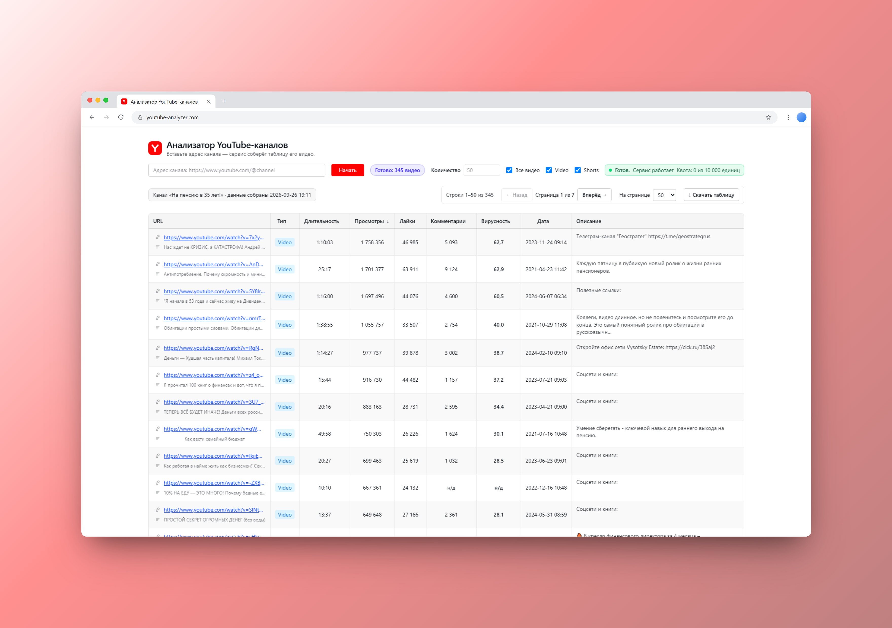

<div align="center">


# 📊 YouTube Analyzer

**Таблица всех Video и Shorts любого канала — с метриками, оценкой вирусности и выгрузкой в Excel.**


</div>

Вставьте адрес канала — сервис обойдёт его целиком через YouTube Data API,
сложит Video и Shorts в одну сортируемую таблицу и сохранит выгрузку в SQLite.
Каждая выгрузка остаётся снимком: к каналу можно вернуться без единого
обращения к API, а два снимка — сравнить и увидеть, что выросло, а что просело.
Авторизации нет, запуск локальный.

<div align="center">



</div>

## 📋 Оглавление

- [✨ Возможности](#-возможности)
- [🚀 Быстрый старт](#-быстрый-старт)
- [🔑 Ключ YouTube Data API](#-ключ-youtube-data-api)
- [⚙️ Переменные окружения](#️-переменные-окружения)
- [📜 Команды](#-команды)
- [📊 Таблица](#-таблица)
- [🔥 Вирусность](#-вирусность)
- [🚫 Про дизлайки](#-про-дизлайки)
- [🎨 Знак сервиса](#-знак-сервиса)
- [🗂️ Структура проекта](#️-структура-проекта)
- [📈 Lighthouse и качество](#-lighthouse-и-качество)
- [🛡️ Безопасность](#️-безопасность)
- [🧰 Стек](#-стек)
- [📄 Лицензия](#-лицензия)

## ✨ Возможности

| Что                   | Подробности                                                                    |
| --------------------- | ------------------------------------------------------------------------------ |
| 🔗 Любой адрес        | `@handle`, `/channel/UC…`, `/c/…`, `/user/…`                                   |
| 📥 Гибкая выгрузка    | Канал целиком или N последних; Video, Shorts или оба                           |
| ⏳ Ход работы         | Прогресс по ходу выгрузки; перезагрузка страницы задание не теряет             |
| 🔢 Таблица            | Девять колонок, сортировка по любой, страницы по 25/50/100                     |
| 📋 Копирование        | Кнопки «скопировать ссылку» и «скопировать название» в каждой строке           |
| 🧭 Компактность       | Поиск, «Начать», настройки и обе плашки — одной строкой                        |
| 📤 Excel              | `.xlsx` со всеми строками, гиперссылками и числовыми форматами                 |
| 🕘 История каналов    | Открытие ранее выгруженного канала без единого обращения к API                 |
| 💾 Архив снимков      | После каждой успешной выгрузки `.xlsx` ложится в `history/`                    |
| 📈 Сравнение выгрузок | Прирост просмотров, лайков и комментариев — числом и долей                     |
| 🛟 Отказы API         | Кончилась квота или не принят ключ — понятное сообщение, собранное не теряется |

## 🚀 Быстрый старт

**Нужно:** Node.js 20.9+ и [ключ YouTube Data API](#-ключ-youtube-data-api).

```bash
git clone https://github.com/lpcms/youtube_analyzer.git
cd youtube_analyzer
npm install                 # postinstall сам сгенерирует клиент Prisma
cp .env.example .env        # Windows: copy .env.example .env
# впишите YOUTUBE_API_KEY в .env
npm run db:deploy           # создаст db/dev.db
npm run dev
```

Откройте http://localhost:3000, вставьте адрес канала, нажмите «Начать».

> **Linux:** `better-sqlite3` собирается из исходников — может понадобиться
> `build-essential` и `python3`. На Windows и macOS ставится готовым бинарником.

## 🔑 Ключ YouTube Data API

1. [Google Cloud Console](https://console.cloud.google.com/) → **New project**.
2. **APIs & Services → Library** → **YouTube Data API v3** → **Enable**.
3. **Credentials → Create credentials → API key** → скопировать.
4. По желанию: **Edit API key → API restrictions** → только YouTube Data API v3.
5. Вписать в `.env`: `YOUTUBE_API_KEY=AIza…`

Оплата не нужна: бесплатной квоты хватает с запасом.

**Квота — 10 000 единиц в сутки.** Список видео берётся через
`playlistItems.list` (1 единица за 50 видео) из плейлиста загрузок, метрики —
через `videos.list` (тоже 1 за 50). Дорогой `search.list` (100 за вызов)
не используется вовсе: канал на 5 000 роликов обходится примерно в 200 единиц.
Кончившаяся квота — не поломка: сервис скажет об этом словами, сохранит
собранное и пометит выгрузку частичной.

## ⚙️ Переменные окружения

| Переменная        | Зачем                         | Пример             |
| ----------------- | ----------------------------- | ------------------ |
| `YOUTUBE_API_KEY` | Ключ YouTube Data API v3      | `AIza…`            |
| `DATABASE_URL`    | Файл SQLite                   | `file:./db/dev.db` |
| `HISTORY_DIR`     | Папка снимков (необязательна) | `./history`        |

**Ключ живёт только на сервере.** Переменная без префикса `NEXT_PUBLIC_` —
именно поэтому ключ не попадает в клиентский бандл. Не переименовывайте её
и не обращайтесь к API из браузерного кода. `.env` в `.gitignore`.

## 📜 Команды

| Команда                 | Что делает                                                    |
| ----------------------- | ------------------------------------------------------------- |
| `npm run dev`           | Дев-сервер на http://localhost:3000                           |
| `npm run build`         | Прод-сборка                                                   |
| `npm start`             | Запуск собранного приложения                                  |
| `npm run lint`          | ESLint по всему проекту                                       |
| `npm run typecheck`     | `tsc --noEmit`: типы без сборки                               |
| `npm run format`        | Prettier, исправление                                         |
| `npm run format:check`  | Prettier, только проверка                                     |
| `npm test`              | Vitest: модульные и интеграционные                            |
| `npm run test:watch`    | То же, в режиме наблюдения                                    |
| `npm run test:coverage` | Тесты с отчётом о покрытии                                    |
| `npm run test:e2e`      | Playwright: сквозные тесты в браузере                         |
| `npm run check:key`     | Проверяет, что ключа API нет в собранном клиентском бандле    |
| `npm run verify`        | `format:check` + `lint` + `typecheck` + `test` одной командой |
| `npm run db:migrate`    | Создать и применить миграцию                                  |
| `npm run db:deploy`     | Применить существующие миграции — этим база и создаётся       |

E2E поднимают собственный сервер на порту 3100 и заглушку YouTube: настоящий
API они не трогают и квоту не расходуют. Перед первым прогоном —
`npx playwright install chromium`.

## 📊 Таблица

| Колонка          | Что в ней                                                  |
| ---------------- | ---------------------------------------------------------- |
| **URL**          | Ссылка на видео и название, у обоих — кнопка «скопировать» |
| **Тип**          | `Video` или `Shorts`                                       |
| **Длительность** | `1:30`, а с часами — `1:02:03`                             |
| **Просмотры**    | Число просмотров                                           |
| **Лайки**        | Число лайков                                               |
| **Комментарии**  | Число комментариев                                         |
| **Вирусность**   | Оценка относительно типичного видео канала                 |
| **Дата**         | Дата публикации в UTC, формат `2026-09-21 14:21`           |
| **Описание**     | Текстом; длинное сворачивается и раскрывается по клику     |

> **«н/д» — это не ноль.** Автор может скрыть лайки или комментарии, и API
> тогда не присылает поле вовсе. Ноль означает «их нет», «н/д» — «нам
> не сказали».

> **`Video ?`** — тип выведен только из длительности: подтвердить его
> обращением к странице Shorts не удалось.

В книге Excel название видео выведено отдельной колонкой: на экране оно
подпись под ссылкой, а в файле по нему удобно фильтровать.

## 🔥 Вирусность

ТЗ задаёт входы, но не формулу. Абсолютная вовлечённость несравнима ни между
каналами, ни между типами, поэтому оценка считается **относительно медианы
по самой выгрузке, отдельно для Video и отдельно для Shorts**:

```
ER         = (лайки + 2 × комментарии) / просмотры
Вирусность = 10 × (0,6 × ER / ER_медиана + 0,4 × просмотры / просмотры_медиана)
```

**10,0 — типичное видео своего типа на этом канале.** У ролика ровно
с медианными вовлечённостью и охватом оба отношения равны единице, веса в сумме
дают единицу — получается ровно 10,0. Больше 10 — лучше обычного для этого
канала, 20,0 — примерно вдвое лучше среднего. Потолок 100, чтобы разовый
всплеск не давал четырёхзначных чисел.

Комментарий весит вдвое против лайка: он требует заметно большего усилия.
Вес вовлечённости (0,6) выше веса охвата (0,4) — вирусность про отклик,
а не про показы.

> Оценка **не сравнима между каналами**: у каждой выгрузки своя медиана.
> Это сравнение видео с соседями по каналу, а не с YouTube вообще.

## 🚫 Про дизлайки

**Столбца «ДизЛайки» нет, и это не недоделка.** YouTube убрал публичные
дизлайки в декабре 2021: их не отдаёт ни API, ни страница видео. Сторонние
сервисы показывают их до сих пор, но там экстраполяция по выборке тех, у кого
стоит расширение, — оценка вместо факта. Ставить её рядом с настоящими
просмотрами значило бы выдавать догадку за данные.

Дизлайки исключены и из таблицы, и из формулы вирусности. Сознательное
отступление от п.3 ТЗ, зафиксированное в
[PRD](docs/prd-youtube-channel-analyzer.md).

## 🎨 Знак сервиса


Красный квадрат со скруглением — узнаваемая форма кнопки YouTube, а внутри
вместо треугольника «плей» стоит **Y**: это анализатор, а не проигрыватель.
Рисуется двумя линиями с круглыми концами, а не буквой из шрифта — текст в SVG
зависит от того, какие шрифты стоят на машине.

<br clear="left" />

| Файл                   | Где используется                                     |
| ---------------------- | ---------------------------------------------------- |
| `src/app/icon.svg`     | Значок во вкладке браузера, подхватывается Next сам  |
| `src/app/logo.tsx`     | Знак в шапке страницы                                |
| `docs/assets/logo.svg` | Векторный знак для документации                      |
| `docs/assets/logo.png` | То же растром — для README и всего, где SVG неудобен |

Все четыре рисуют один и тот же путь; совпадение стережёт тест
(`tests/unit/logo.test.tsx`): разъехавшийся знак глазами почти не заметить.

## 🗂️ Структура проекта

```
src/app/        страница, форма, таблица, серверные действия
src/lib/        выгрузка, расчёты, форматирование, работа с API и базой
src/proxy.ts    Content-Security-Policy с одноразовым nonce
prisma/         схема базы и миграции
scripts/        проверка, что ключа нет в клиентском бандле
tests/          unit — Vitest, e2e — Playwright, db — фикстуры
docs/           ТЗ, PRD, план, задачи, регламент тестирования, отчёт о приёмке
docs/assets/    знак сервиса в SVG и PNG, снимок экрана для README
db/             файлы SQLite (в репозиторий не попадают)
history/        архив снимков .xlsx (тоже не попадают)
```

Папку `history/` можно удалить в любой момент: это архив, а не хранилище.
Все данные сервис читает из SQLite и без неё работает так же.

## 📈 Lighthouse и качество

Прод-сборка, headless Chrome — подробности в
[отчёте о приёмке](docs/acceptance-report.md).

| Категория      | Оценка |
| -------------- | ------ |
| Performance    | 84–85  |
| Accessibility  | 100    |
| Best Practices | 100    |
| SEO            | 100    |

FCP 1,0 с · LCP 4,1 с · TBT ~180 мс · CLS 0.

Performance упирается в LCP, а тот — в render delay: страница объявлена
`force-dynamic`, потому что показывает живые данные, а Lighthouse вдобавок
душит процессор вчетверо. Разметка приезжает быстро, сдвигов макета нет вовсе,
ответ сервера — 40 мс.

**Проверки:** 503 модульных и интеграционных теста, 94 E2E, axe без нарушений
на обеих страницах, `npm audit` — ноль уязвимостей.

## 🛡️ Безопасность

| Заголовок                 | Значение                                                                      |
| ------------------------- | ----------------------------------------------------------------------------- |
| `Content-Security-Policy` | `default-src 'self'`, скрипты по одноразовому nonce, `frame-ancestors 'none'` |
| `X-Content-Type-Options`  | `nosniff`                                                                     |
| `X-Frame-Options`         | `DENY`                                                                        |
| `Referrer-Policy`         | `strict-origin-when-cross-origin`                                             |
| `Permissions-Policy`      | камера, микрофон, геолокация выключены                                        |

Статические заголовки — в `next.config.ts`, CSP — в `src/proxy.ts`: nonce обязан
быть свой на каждый ответ, из статического конфига такого не выдать. Всё
проверяется по настоящему ответу сервера, а не по содержимому конфига.

Ключ API не покидает сервер: это стережёт `npm run check:key`, который ищет
в собранном бандле **значение** ключа. Имя переменной там встречается законно —
внутри сообщения «проверьте `YOUTUBE_API_KEY` в файле `.env`».

## 🧰 Стек

| Слой      | Технология                                          |
| --------- | --------------------------------------------------- |
| Фреймворк | Next.js 16 (App Router, Turbopack), React 19        |
| Язык      | TypeScript 5.9, strict + `noUncheckedIndexedAccess` |
| База      | SQLite через Prisma 7 и `better-sqlite3`            |
| Стили     | Tailwind CSS 4                                      |
| Excel     | ExcelJS (подключается динамически, на сервере)      |
| Тесты     | Vitest 4 + Testing Library + MSW, Playwright        |
| Качество  | ESLint 9, Prettier                                  |

## 📄 Лицензия

[MIT](LICENSE)
